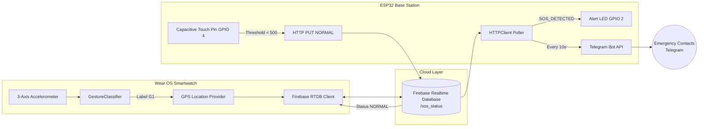
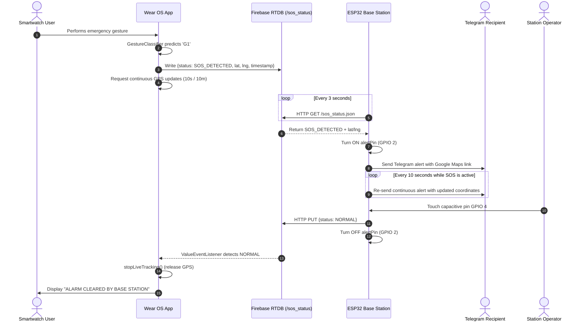

# Smartwatch Edge-AI Gesture SOS System with ESP32 Base Station

[](https://developer.android.com/wear)
[](https://www.espressif.com/)
[](https://kotlinlang.org/)
[-blue.svg)](https://www.arduino.cc/)
[](https://firebase.google.com/)
[](LICENSE)

An end-to-end emergency alert system bridging a **Wear OS smartwatch** running an on-device machine learning gesture classifier, **Firebase Realtime Database**, and an **ESP32 IoT base station** equipped with capacitive touch reset and automated **Telegram emergency dispatch**.

---

## Overview

Traditional emergency distress beacons require conscious, precise manual button presses. This system implements wrist gesture recognition directly on a Wear OS smartwatch (tested on Galaxy Watch4).

When an emergency gesture (`G1`) is detected:
1. The smartwatch writes the distress status and current GPS coordinates to Firebase Realtime Database.
2. The watch initiates continuous high-frequency location streaming (10 s / 10 m).
3. A remote ESP32 IoT base station polls Firebase, illuminates an alert LED, and dispatches periodic Telegram emergency alerts with direct Google Maps coordinates.
4. Touching a capacitive sensor on the ESP32 resets the alert state in Firebase, which triggers a real-time callback on the smartwatch to halt GPS polling and restore normal operation.

---

## Architecture & How It Works

### System Topology



### Sequence Flow



---

## Firebase Data Schema

All communication between the smartwatch and the ESP32 base station synchronizes across a single Firebase Realtime Database path:

```json
{
  "sos_status": {
    "status": "SOS_DETECTED",
    "latitude": 23.155842,
    "longitude": 72.666914,
    "timestamp": "2026-11-12 01:30:00"
  }
}
```

- **`status`**: String enum (`"SOS_DETECTED"` or `"NORMAL"`).
- **`latitude`**: Floating-point WGS-84 latitude.
- **`longitude`**: Floating-point WGS-84 longitude.
- **`timestamp`**: Formatted UTC/Local timestamp (`yyyy-MM-dd HH:mm:ss`).

---

## Hardware Configuration (ESP32 Base Station)

| Component | Pin / Specification | Function |
|---|---|---|
| Microcontroller | ESP32 Development Board (ESP-WROOM-32) | Core IoT processor with 2.4 GHz Wi-Fi |
| Alert Indicator | GPIO 2 (Built-in LED) | Illuminates continuously when `isSOSActive == true` |
| Capacitive Reset | GPIO 4 (Touch Pin T0) | Reads capacitive touch value via `touchRead(4)` |
| Touch Threshold | `500` (Debounce: `3000 ms`) | Detects human finger touch to clear the distress state |

---

## Repository Structure

```text
emergency-sos-gesture-system/
├── esp32-base-station/
│   └── esp32_base_station/
│       └── esp32_base_station.ino    # ESP32 firmware (HTTPClient, ArduinoJson v7, Telegram)
├── wear-os-app/
│   └── app/src/main/java/com/example/gesturesos/presentation/
│       └── MainActivity.kt           # Wear OS Compose UI, sensor loop, Firebase client
├── docs/
│   └── ARCHITECTURE.md               # Detailed communication protocol specification
├── media/
│   └── .gitkeep                      # Assets folder for demo media
├── .gitignore
├── LICENSE
└── README.md
```

---

## Not Included Yet (TODOs)

> [!NOTE]
> To keep the repository focused on the firmware and integration logic, certain modules are currently omitted and marked as **TODO**:

- [ ] **TODO: GestureClassifier Implementation**: The standalone Kotlin classifier object (`GestureClassifier.predict`, `GestureClassifier.confidence`, `GestureClassifier.SAMPLE_COUNT`) is external to this repository.
- [ ] **TODO: Trained Machine Learning Model & Weights**: Model artifacts (e.g., Random Forest decision trees or TFLite flatbuffers) must be placed in the Wear OS assets directory.
- [ ] **TODO: Training Dataset & Notebook**: Accelerometer training data, preprocessing scripts, and feature extraction pipeline are not yet published.
- [ ] **TODO: Wear OS Gradle Build System**: `build.gradle.kts`, `settings.gradle.kts`, `libs.versions.toml`, and `AndroidManifest.xml` (with `BODY_SENSORS` and `ACCESS_FINE_LOCATION` declarations).
- [ ] **TODO: Theme Definitions**: Composable theme package `com.example.gesturesos.presentation.theme.GestureSOSTheme`.

---

## Setup & Deployment Guide

### 1. Firebase Configuration
1. Create a project in the [Firebase Console](https://console.firebase.google.com/).
2. Create a **Realtime Database** instance in test mode.
3. Note your database URL: `https://YOUR_PROJECT_ID-default-rtdb.firebaseio.com`.

### 2. Telegram Bot Configuration
1. Message `@BotFather` on Telegram and send `/newbot` to generate a Bot Token.
2. Send a direct message to your bot or add it to your alert channel.
3. Obtain your Chat ID using `@userinfobot` or `https://api.telegram.org/bot<TOKEN>/getUpdates`.

### 3. ESP32 Base Station Setup
1. In the Arduino IDE Library Manager, install **ArduinoJson** (version 7.x, required for `JsonDocument`).
2. Open `esp32-base-station/esp32_base_station/esp32_base_station.ino`.
3. Replace the placeholder constants with your actual credentials:
   - `YOUR_WIFI_SSID`
   - `YOUR_WIFI_PASSWORD`
   - `YOUR_PROJECT_ID`
   - `YOUR_TELEGRAM_BOT_TOKEN`
   - `YOUR_TELEGRAM_CHAT_ID`
4. Select board **ESP32 Dev Module** and upload the firmware.

### 4. Wear OS App Configuration
1. Open `wear-os-app/app/src/main/java/com/example/gesturesos/presentation/MainActivity.kt`.
2. Replace `YOUR_PROJECT_ID` with your Firebase project name.
3. Grant **Location** and **Sensors** permissions when prompted on the watch.

---

## Challenges & What I Learned

- **Asynchronous Bidirectional State Synchronization**: Coordinating state transitions between low-power embedded edge devices and Android clients without WebSockets requires polling on the micro-controller paired with long-lived WebSocket listeners (`ValueEventListener`) on Android.
- **Power Budget During Distress Tracking**: Requesting dual-provider GPS (`GPS_PROVIDER` + `NETWORK_PROVIDER`) at high frequency (10 s intervals) drains battery rapidly. Stopping the listener immediately when receiving the `NORMAL` reset state is essential to preserve battery life.
- **Capacitive Touch Debouncing**: Raw touch readings on ESP32 floating pins fluctuate with environmental humidity. Establishing a threshold (`< 500`) combined with a software debounce cooldown (`3000 ms`) prevents false triggers.

---

## Future Improvements & Security Considerations

> [!WARNING]
> **Current Security Posture**:
> The ESP32 currently communicates with Firebase via unauthenticated REST calls (`HTTPClient.GET` and `HTTPClient.PUT`). This implementation requires open database rules, meaning any client possessing the database URL could theoretically overwrite or clear an alert. **The current prototype must not be deployed in production environments without authentication.**

- [ ] **Firebase Authentication & Security Rules**: Integrate Firebase Auth on the ESP32 (via service account tokens or custom JWTs) and restrict Realtime Database read/write access to authenticated clients.
- [ ] **HTTPS Certificate Validation**: Implement root CA certificate pinning (`WiFiClientSecure`) on the ESP32 to eliminate potential man-in-the-middle vulnerabilities during Telegram dispatch.
- [ ] **Continuous Gesture Inference**: Replace manual "Start Detection" window triggering with continuous sliding-window inference on the accelerometer stream.

---

## License & Contact

Distributed under the **MIT License**. See [LICENSE](LICENSE) for details.

- **Author**: Rudra Patel
- **Institution**: Pandit Deendayal Energy University (PDEU), B.Tech ICT
- **Target Role**: Embedded Software / Firmware Engineer
- **LinkedIn**: [linkedin.com/in/rudra-patel0314](https://www.linkedin.com/in/rudra-patel0314/)
- **Email**: [rudrapatel0314@gmail.com](mailto:rudrapatel0314@gmail.com)
